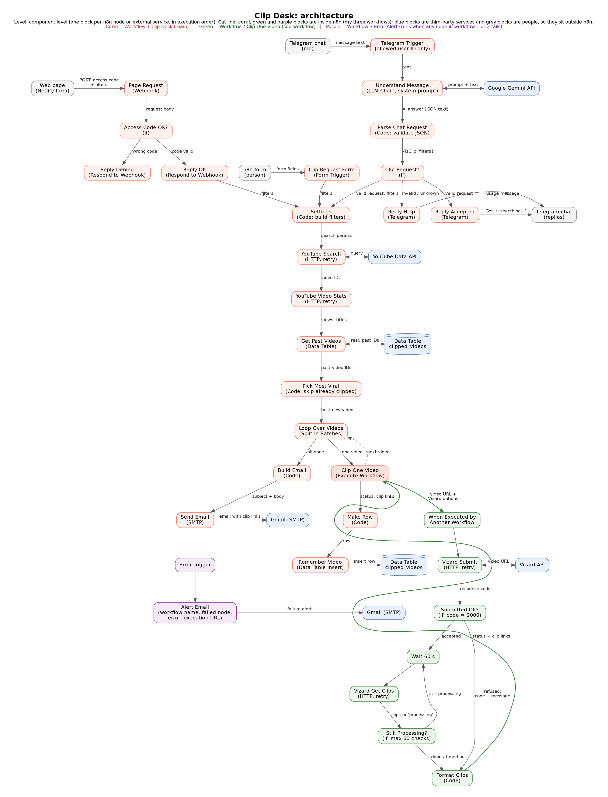

# Clip Desk

Clip Desk is an n8n automation that turns long YouTube videos into short clips without an editor. You describe the video you want. It finds one on YouTube, has Vizard AI cut it into short vertical clips with captions, and emails you the links.

Built for the no-code class (Centrale–ESSEC, Year 3) on n8n Cloud.



## How it works

| Step | What happens |
|---|---|
| **1. Ask** | There are four ways in: the Clip Desk **web page**, a **Telegram** message (Gemini turns plain words into filters), the built-in **n8n form**, or the **daily schedule** (08:00, default filters). All four feed the same `Settings` node. |
| **2. Find** | The YouTube Data API searches with your filters and fetches stats for up to 50 results. `Pick Most Viral` removes live streams, music, the wrong audio language, videos that are too long or have too few views, and videos already clipped, then keeps the most viewed (1–3). |
| **3. Clip** | The **Clip One Video** sub-workflow sends each video URL to Vizard, then checks every 60 s (up to 60 checks) until the clips are ready. |
| **4. Remember** | Every video sent to Vizard is saved in the `clipped_videos` n8n Data Table, so a video is never clipped twice. |
| **5. Deliver** | One HTML email (Gmail SMTP) gives each clip's title, viral score, length, a download link (valid 7 days) and a Vizard edit link. If there are no clips, no email is sent. |

## Repository layout

```
workflows/
  clip-desk-main.json            # Workflow 1: triggers, YouTube search, loop, database, email
  clip-desk-clip-one-video.json  # Workflow 2: sub-workflow, Vizard submit + polling
  clip-desk-error-alert.json     # Workflow 3: error workflow, emails the owner when a run fails
web/
  index.html                     # Clip Desk request page (static, hosted on Netlify)
docs/
  architecture.png               # Component-level architecture of the three workflows
  scoping.pdf                    # Scoping deliverable (8 October 2026)
  presentation.pdf               # Class presentation slides
```

## Class requirements covered

| Requirement | Where |
|---|---|
| If / router | `Access Code OK?`, `Clip Request?`, `Submitted OK?`, `Still Processing?`, `Loop Over Videos` |
| Code node | `Settings`, `Parse Chat Request`, `Pick Most Viral`, `Make Row`, `Build Email`, `Format Clips` |
| API connection | YouTube Data API v3 (search + videos), Vizard open API (create project + query) |
| Message trigger | `Telegram Trigger` (limited to an allow-listed Telegram user ID) |
| Database | n8n Data Table `clipped_videos` (`Get Past Videos`, `Remember Video`) |
| AI node | `Understand Message`, an LLM Chain on Google Gemini (`gemini-flash-latest`) |
| Sub-workflow | `Clip Desk - Clip One Video`, called once per video, so each video gets its own 60-check limit |
| Errors + retries | Retry-on-fail on every API node and on the alert email; `Clip Desk - Error Alert` error workflow; clear error when nothing matches; 403 on a wrong access code; no email when there are no clips |

## Request fields

The web page, form and Telegram parser all use the same field labels:

`Email`, `Access code` (web page only), `Language` (English, Spanish, French, German, Portuguese), `Region` (US, GB, FR, CA, DE, IN), `Keyword (optional)`, `Category`, `Published within`, `Sort by`, `Minimum views`, `Max video length` (5–20 min), `Number of videos` (1–3), `Clips per video` (3, 5, 10), `Clip length`, `Aspect ratio` (9:16, 1:1, 16:9), `What should the clips be about?`

When a field is blank, `Settings` uses the value in its `DEFAULTS` block.

## Setup

1. **Import** the three JSON files from `workflows/` into n8n. Import the sub-workflow and the error workflow first.
2. **Create credentials** and attach them to the nodes:
   - **Query Auth** for the YouTube Data API: query parameter `key` = your Google Cloud API key (YouTube Data API v3 enabled).
   - **Header Auth** for Vizard: header `VIZARDAI_API_KEY` = your Vizard API key.
   - **Google Gemini (PaLM) API**: your Gemini API key.
   - **Telegram API**: your bot token from @BotFather.
   - **SMTP** for Gmail: `smtp.gmail.com`, port 465, SSL, with a Gmail app password.
3. **Reconnect the IDs that change when you import:**
   - In the main workflow, the `Clip One Video` node: select the imported *Clip Desk - Clip One Video* workflow.
   - In the main workflow settings: set **Error Workflow** to *Clip Desk - Error Alert*.
4. **Edit the values that belong to you:**
   - `Access Code OK?`: replace `CHANGE_ME_ACCESS_CODE` with your shared access code. The real code is not committed.
   - `Telegram Trigger`: set **Restrict to User IDs** to your own Telegram user ID.
   - `Settings`: set `email` / `senderEmail` and any default filters you want to change.
   - `Alert Email`: set the from and to addresses.
   - `web/index.html`: set `WEBHOOK_URL` to your instance's production webhook URL (`…/webhook/clip-request`).
5. **Create the table once:** run the `Run Once: Setup` manual trigger to create `clipped_videos`. It is safe to run twice. You can delete those two nodes afterwards.
6. **Daily schedule:** `Daily Trigger` is **disabled** in the export, so enable it if you want the 08:00 run. It uses the instance timezone (set it to Europe/Paris in the workflow settings if needed).
7. **Publish/activate** the main workflow, then deploy `web/index.html` to any static host (Netlify was used).

## Design choices

- **Links, not files.** Vizard downloads the YouTube video itself, so nothing is downloaded in n8n.
- **Search, not the trending chart.** YouTube retired its Trending page in 2025, so videos come from a filtered search sorted by views.
- **Polling.** Clipping takes minutes, so the sub-workflow checks Vizard every 60 s, up to 60 times, then gives up on that video.
- **A person reviews the clips.** They are emailed, not posted automatically.
- **Cost guards.** An access code, a cap on source video length and at most 3 videos per request protect the monthly Vizard allowance (about 600 minutes). A duration YouTube can't parse is treated as too long.
